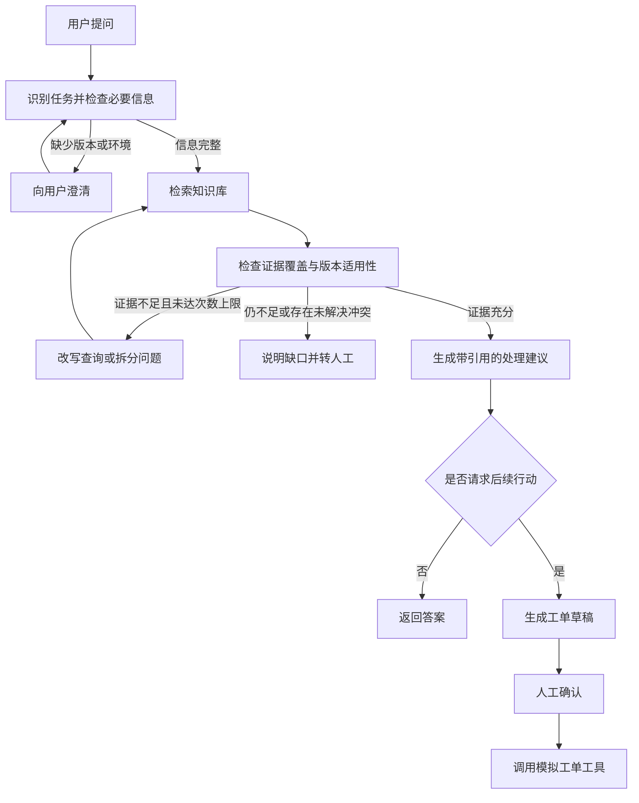

# RAG Demo 方案：从知识问答到可追溯工作流

## 1. 演示定位

构建一个有依据、可控制、可评估的 AI 技术支持工作流：能够检索知识、澄清信息缺口、根据证据决定下一步、等待人工确认并调用业务工具，同时记录可观察的执行过程，通过评估验证工作流质量。

本项目重点展示 AI 工作流设计、工具调用、人工参与、可观测性与评估能力。Python 编程、测试自动化和数据分析能力由独立的 `Python_Proj` 项目展示。

### 核心技术分工

- **RAG**：检索业务知识，为回答提供可核查的依据。
- **LangGraph**：作为工作流主线，管理共享状态、条件分支、有限重试、人工确认、暂停与恢复，以及业务工具调用。
- **LangSmith**：追踪检索、节点和工具执行，定位失败原因；通过固定评估集比较方案、检查回归，并衡量质量、延迟与成本。

核心叙事：从“回答问题”逐步走向“有依据地推进工作”，再通过追溯和评估持续改进。

### 面向目标岗位的展示价值

结合 Agile Robots Mechatronics Test Engineer 岗位中的技术支持、结构化问题分析和演示职责，选择观众容易理解的工程业务场景。重点说明如何把知识、流程和工具组织成可靠的 AI 应用；具体业务主题在第 2 节确定。

演示应让观众看清：回答依据是什么，信息不足或证据冲突时如何处理，何时需要人工参与，以及如何验证修改是否带来改善。AI 执行追踪用于观察输入、证据、路由结果和工具调用；工程需求与测试结果的追溯仍需显式记录业务标识和关联关系。

### 第一版配套组件

| 组件 | 用途 |
| --- | --- |
| LLM 与 Embedding 模型 | 理解任务、生成回答与结构化结果，以及文档向量化；供应商和型号待实现阶段选择 |
| Chroma 本地向量库 | 存储并检索文档片段，保留来源、版本和适用范围等 metadata |
| Pydantic | 定义并校验澄清结果、证据检查结果、工具参数和工单草稿等结构；结构校验不等于内容正确 |
| SQLite Checkpointer | 保存 LangGraph 状态，支持人工确认后的继续执行，并为跨进程恢复提供基础 |
| Streamlit | 展示对话、引用、当前流程状态、业务草稿和人工确认入口 |
| 一个模拟业务工具 | 经确认后实际创建本地工单或其他业务记录，返回标识，并避免恢复时重复创建；具体工具随主题确定 |

LangSmith 同时承担追踪与评估，第一版无需额外引入评估平台。混合检索、Reranker、MCP 和 FastAPI 在出现明确需求后再考虑；第一版采用直接工具调用和单张工作流图。

## 2. 知识主题选择

### 已确定主题：机械臂测试台架升级后的初始化与通信异常排查助手

采用融合方案：以 ARRK 工作中的结构化排障方法为基础，结合公开机器人资料和完全合成的台架案例，构建可分享、可复现的 AI 技术支持工作流。

ARRK 提供方法基础，公开机器人资料提供可核查知识，合成台架提供可控的演示环境。具体台架为独立设计的演示场景，不代表 ARRK、客户或 Agile Robots 的实际系统。

### 经验基础与第一版范围

借鉴 ARRK 工作中的 bring-up、软硬件版本匹配、网络诊断和质量分析方法：出现故障报告时，先区分产品、软件监控与测试环境等可能原因，再根据证据决定下一步验证。故障报告本身不等于硬件损坏。

第一版主线为：测试工作站更新后，机械臂测试台架无法完成初始化并出现连接超时。助手检查上下文、检索适用资料、读取模拟诊断结果，形成排查建议；仍无法解决时，经人工确认创建支持工单。

后续可增加“过温告警与测量链排查”作为第二案例，借鉴热测试、参考传感器和冷却系统检查方法。电源故障注入和功耗测量暂不作为第一版主线。

已实现的关节响应扩展：**关节动作出现超调或振荡时的辅助排查**。采用离线单关节 PD 位置响应（积分项为零），包含基准、低阻尼振荡、负载信息缺失三种工况。程序生成轨迹并计算指标，助手收集控制配置、运动表现和测试条件，检索适用说明，整理待验证假设；不预设 PID 参数就是根因，不自动调参。模型、指标与接口见 [关节响应案例](docs/joint_response_demo.md)。当前已接入 Claude/LangGraph，支持负载澄清、报告评审及工单审批，75 项离线测试通过，三种工况真实运行与 LangSmith 回读完成。

该案例来自用户对一轮面试的回忆：系统测试组长在机械臂功能测试示例中提及 PID 相关信息或动作。结合语境，暂按控制理论中的 PID 理解；原话及具体测试内容尚待确认，不视为已确认的岗位要求。此案例作为新增扩展，不替换当前“初始化与通信异常排查”主线。

经验参考：

- `../JD_Dashboard/Info_Input/WorkExperience_ARRK/WorkExperience_ARRK/arguments_Verteidigung.txt`
- `../JD_Dashboard/Taget_Job/Test_Engineer/Agile_Robots_Mechatronics_Test_Engineer/InterviewPreperation/ARRK_Technical_Discussion_EN.md`

### 数据脱敏与素材边界

- 从通用工程方法重新编写合成案例，不通过简单替换名称直接改造内部资料。
- 产品结构、版本组合、阈值、故障映射、日志和调查结论均独立设计；所有合成内容明确标注为演示数据。
- 内部文档、原始日志、代码、截图和客户标识不进入演示知识库、模型请求或 LangSmith Trace。
- 公开知识保留来源链接、文档版本与适用范围；演示台架规则与厂商真实说明分别标注，不把虚构结论归于厂商。
- 对外描述为“受实际测试支持经验启发的独立演示”，不声称已在 ARRK 或目标公司部署。

### 公开资料与开源项目参考

| 来源 | 借鉴内容 | 本项目中的用途 |
| --- | --- | --- |
| [Franka 官方 franka_ros2](https://github.com/frankarobotics/franka_ros2) | 机器人软件集成、配置与排障入口 | 提供真实技术背景；第一版不要求部署完整 ROS 2 环境 |
| [Franka 官方 FCI 排障文档](https://frankarobotics.github.io/docs/troubleshooting.html) | 连接超时、通信异常、网络检查和库版本不兼容 | 第一版优先参考的知识来源 |
| [Franka 软件兼容性说明](https://frankarobotics.github.io/docs/compatibility.html) | 系统与客户端版本的兼容关系 | 支持版本澄清和资料适用性检查 |
| [selfpatch/ros2_medkit](https://github.com/selfpatch/ros2_medkit) | 故障、状态、故障快照的 REST API，以及无实体机器人诊断 Demo 入口 | 借鉴诊断工具接口；后续可评估真实接入 |
| [earosenfeld/robot-test-bench](https://github.com/earosenfeld/robot-test-bench) | 电机、传感器与伺服仿真，以及示例数据和 Dashboard | 可选的台架组成与模拟素材参考 |

以上项目已初步查看文档和仓库介绍，尚未下载、运行或验证。它们不是现成的机械臂测试台架维护助手；具体复用前还需核查适用版本、许可证和运行条件。第一版优先使用公开文档与自建模拟诊断工具，避免把环境搭建变成演示主线。

### 自然形成的 AI 工作流

1. **澄清上下文**：机器人型号、系统与客户端版本、完整错误信息，以及更新内容。
2. **检索处理知识**：查询排障文档、兼容性说明和自编的演示台架规程，检查来源与适用范围。
3. **读取现场证据**：调用模拟工具获取版本清单、连接状态和日志摘要；运行时诊断结果与静态知识分别管理。
4. **根据证据推进**：缺少信息则补查，存在冲突则说明；输出有引用的排查建议，并区分事实、假设和待验证事项。
5. **人工确认后创建工单**：草稿包含已知事实、已完成检查、未解决问题及附件清单，允许人工修改，创建后返回工单 ID 并避免重复创建。
6. **追踪与评估**：通过 LangSmith 检查必要信息是否被询问、引用是否适用、工具调用是否正确，以及是否出现无依据的硬件损坏结论。

RAG 提供处理知识，诊断工具提供当前台架状态，LangGraph 根据两者管理流程，LangSmith 观察并评估流程表现。第一版业务动作集中于读取模拟诊断和创建本地工单。

### 知识库材料规划

准备约 10～15 篇短文档，覆盖演示台架结构、初始化流程、版本兼容规则、连接与通信排查、日志采集、合成历史案例，以及支持升级与工单规则。旧版和现行资料明确标注版本、适用范围与状态，避免把已失效说明当作当前依据。

每个演示问题预先定义应检索的资料、需要补充的信息、允许调用的工具与预期流程结果，便于建立评估集。

## 3. 核心演示问题

> 测试工作站更新后，机械臂测试台架无法完成初始化，出现连接超时。请帮我排查；如果仍无法解决，请准备一份支持工单。

这个问题同时包含知识查询和行动请求，适合展示澄清、跨文档检索、证据检查与人工确认。

## 4. LangGraph 编排设计

实现状态：已完成诊断图、一次检索重试、澄清与跨进程恢复、校验和一次纠正，并已接上本地工单草稿、修改/确认/取消和幂等创建。节点与入口见 [当前工作流](docs/langgraph_workflow.md)，审批及存储规则见 [本地工单闭环](docs/ticket_workflow.md)。当前未接外部工单系统。

### 三个重点分支

1. **澄清后继续**：缺少版本、环境等必要信息时先追问；补充后利用共享状态继续处理。
2. **有界检索重试**：证据不完整时改写查询，或拆成“故障原因”和“升级条件”分别检索；最多追加一到两轮，仍不足则说明缺口。
3. **确认后执行**：先生成工单草稿，通过 `interrupt()` 暂停；用户确认后恢复并调用模拟工具。

证据充分性应检查问题是否得到覆盖、版本是否适用、资料是否冲突，不能只依赖向量相似度分数。

### 状态与恢复

建议共享状态至少包含：用户问题、版本与环境、澄清结果、检索查询、证据片段、重试次数、路由结果、答案、工单草稿和确认状态。

使用 checkpointer 和 `thread_id` 管理暂停与恢复；跨进程恢复需要持久化 checkpointer。模拟工单工具应避免重复创建，便于安全演示恢复流程。

第一版使用节点、条件边和共享状态即可，无需引入多个 Agent。

## 5. LangSmith 监控与过程追溯

### 展示层次

| 层次 | 展示内容 | 回答的问题 |
| --- | --- | --- |
| 单次 Trace | 原始问题、改写查询、召回片段、节点输入输出、工具调用、耗时 | 这次回答经过了什么？ |
| 聚合监控 | 延迟、错误率、Token、可用成本统计及自定义质量指标 | 系统运行得怎么样？ |
| 评估比较 | 同一组问题上基础 RAG 与编排版的表现 | 加入流程是否带来改进？ |

### 建议记录的信息

- **证据**：文档 ID、片段 ID、文档版本、知识库版本。
- **流程**：分支选择、信息缺口、重试原因与次数。
- **上下文**：模型、提示词版本、`thread_id`。
- **结果**：答案引用、拒答或转人工情况、工单状态、用户反馈。

检索内容、自定义路由原因等信息需要显式埋点。这里的过程追溯是可观察的输入、证据、决策结果和执行记录，不代表模型内部思维的完整还原。

## 6. 评估设计

准备 15～20 道题，覆盖：

- 普通事实查询。
- 跨文档综合。
- 缺少版本或环境，需要澄清。
- 旧版与现行资料冲突。
- 首次检索不足，需要改写或拆分。
- 知识库没有答案，应说明缺口。
- 请求创建工单，需要人工确认。

比较基础 RAG 与编排版时，保持模型和知识库一致，记录配置差异。重点指标：

| 指标 | 检查方式 |
| --- | --- |
| 预期文档是否命中 | 对照标注的文档或片段 ID |
| 答案是否有依据 | 人工审核结合 LLM 评审 |
| 引用是否支持结论 | 检查引用内容与对应陈述 |
| 澄清、拒答、转人工是否正确 | 对照预期行为与执行轨迹 |
| 工具执行是否符合确认结果 | 检查确认状态、参数和调用记录 |
| 延迟与成本 | 比较运行统计，并说明质量收益的代价 |

先用离线实验比较方案，再考虑在线抽样评估。不要预设编排版一定更好，以实际结果说明收益和代价。

## 7. 现场演示安排（8～10 分钟）

| 环节 | 内容 | 展示价值 |
| --- | --- | --- |
| 1 分钟 | 介绍演示台架与知识文档 | 建立业务背景 |
| 2 分钟 | 普通问题，返回答案和引用 | 展示 RAG 的证据能力 |
| 2 分钟 | 缺少版本的故障问题，补充后检索与重试 | 展示条件编排与状态 |
| 2 分钟 | 生成工单草稿，确认后调用模拟工具 | 从问答延伸到行动 |
| 2～3 分钟 | 查看 Trace 与预先运行的评估结果 | 展示定位问题和衡量改进 |

重点准备一条“首次检索不足、第二次找到依据”的 Trace，沿着查询、召回文档、路由结果和最终引用解释整个过程。

提前验证演示问题和分支能稳定触发。评估实验提前跑完，现场展示结果；可保留已完成的 Trace 作为网络或模型服务异常时的演示备份，并明确其为历史运行记录。

## 8. 第一版范围

- 一个机械臂测试台架排障 Markdown 知识库。
- 一套基础 RAG，作为比较基线。
- 一张 LangGraph 图，包含澄清、检索重试和人工确认三个关键分支。
- 一个模拟工单工具。
- 一个简单聊天界面，展示答案、引用、当前节点和工单草稿。
- LangSmith tracing 和一组评估题。

后续可以沿着真实工单系统接入、持久化恢复、更多知识源和在线质量监控逐步扩展。

## 9. 官方参考资料

- [LangGraph 工作流与 Agent 模式](https://docs.langchain.com/oss/python/langgraph/workflows-agents)
- [LangGraph Interrupts：暂停与恢复](https://docs.langchain.com/oss/python/langgraph/interrupts)
- [LangSmith Observability](https://docs.langchain.com/langsmith/observability)
- [LangSmith Evaluation Concepts](https://docs.langchain.com/langsmith/evaluation-concepts)
