# Project folder structure

For a readable standalone view, open [the offline folder viewer](folder_structure.html)
in a browser. It uses the same Mermaid hierarchy in a vertical tree layout and
supports full screen, zoom, scrolling and collapsible folders without a server
or network connection. Regenerate it with `python scripts/render_folder_viewer.py`
after changing the Mermaid source.

This is a map of selected actual folders and entry points, not an execution-flow
or dependency diagram. It omits individual fixtures, caches and dependency files
for readability. The editable source is [folder_structure.mmd](folder_structure.mmd).
Open this Markdown in a Mermaid-capable preview to render it.

```mermaid
flowchart TB
    root["RAG_Demo/"]
    root --> entry["Project entry points"]
    entry --> ui["streamlit_app.py - bilingual Dashboard"]
    entry --> guidance["README.md / AGENTS.md / RAG_DEMO_PLAN.md"]
    entry --> config["requirements.txt / .streamlit/config.toml / .gitignore"]

    root --> app["rag_demo/ - AI application"]
    app --> workflow["workflow.py - LangGraph state and routing"]
    app --> reasoning["diagnosis.py / review.py - generation and review"]
    app --> grounding["retrieval.py / facts.py - retrieval and source binding"]
    app --> support["dashboard.py / tickets.py / tracing.py / config.py / ui_i18n.py"]

    root --> knowledge["knowledge/ - curated RAG documents"]
    knowledge --> topics["00_overview/ / 10_configuration/ / 20_procedures/"]
    knowledge --> guidance_topics["30_troubleshooting/ / 50_support/"]
    knowledge --> reserved["40_cases/ - reserved; archived/ - excluded from current index"]

    root --> simulator["simulator/ - synthetic evidence and read-only tools"]
    simulator --> models["motion.py / motion_tools.py / tools.py"]
    simulator --> transport["ros_capture.py / http_motion.py"]
    simulator --> initial["scenarios/ - initialization state.json and diagnostic.log"]
    simulator --> motion["motion_scenarios/ - joint-response state.json and trajectory.csv"]

    root --> ros["ros2/bench_replay/ - project-owned ROS 2 package"]
    ros --> nodes["bench_replay/publisher.py / collector.py / runtime.py"]
    ros --> package["package.xml / setup.py / setup.cfg / resource/"]

    root --> scripts["scripts/ - run, inspect, validate and prepare"]
    scripts --> run["graph_bench.py / diagnose_bench.py / smoke_trace.py"]
    scripts --> bridge["ros_replay_bridge.py / build_ros_replay.sh / run_ros_replay.sh"]
    scripts --> inspect["inspect_*.py / generate_motion_fixtures.py / validate_fixtures.py"]
    scripts --> checks["evaluate_review.py / check_language.py / setup and verification scripts"]
    scripts --> presentation["prepare_interview_demo.py / render_interview_diagrams.py"]

    root --> docs["docs/ - design, operation and provenance"]
    docs --> design["Bench, motion, workflow, tickets, Dashboard and WSL/ROS guides"]
    docs --> interview["interview_demo/ - notes, run of show, Mermaid, SVG and PNG"]
    docs --> provenance["sources.md / source_manifest.json / diagnosis_validation.md"]

    root --> tests["tests/ - offline tests with fake models"]
    root --> evaluation["evaluation/cases/ - review regression inputs, excluded from RAG"]

    root --> data["data/ - ignored local runtime artifacts"]
    data --> persisted["checkpoints/ / runs/ / tickets/ / ros_captures/"]
    data --> generated["index/ / models/ / motion_reports/ / presentation/ / wsl_validation/"]

    root --> references["references/repos/ - ignored third-party clones; keep unchanged"]
    references --> vendors["docs / libfranka / libfranka-common / franka_ros2 / franka_description / labs"]
    root --> environment[".venv/ - ignored local Python dependencies"]

    classDef local fill:#fff4df,stroke:#ae751b,color:#43351c
    classDef external fill:#edf0f5,stroke:#6a788b,color:#27374a
    class data,persisted,generated local
    class references,vendors,environment external
```

## How to explain the structure

- `knowledge/` supplies curated static procedures and requirements.
- `simulator/` supplies synthetic observations, trajectories, deterministic metrics
  and read-only adapters. Fixtures and evaluation expectations are not RAG documents.
- `ros2/bench_replay/` transports synthetic replay through actual ROS nodes.
- `rag_demo/` binds evidence, retrieves knowledge and coordinates the AI workflow.
- `scripts/` provides command-line operation, validation and presentation preparation.
- `docs/interview_demo/` contains the interview materials, including the
  separate Chinese translations under `Chinese/`; the original documents remain English.
- `tests/` checks behavior offline; `evaluation/cases/` holds fixed review examples.

## Versioned material versus local-only material

| Area | Ownership / lifecycle | Git and language treatment |
| --- | --- | --- |
| Application, scripts, knowledge, fixtures, tests and docs | Project-generated and maintained | Versioned; English by default with explicit bilingual exceptions |
| `data/` | Local checkpoints, captures, indices, results and presentation inventory | Ignored; historical evidence is not rewritten for translation |
| `references/repos/` | Third-party clones and their original sources | Ignored; keep files unchanged, including their original language |
| `.venv/` | Local third-party Python dependencies | Ignored; not project prose |

`40_cases/` is currently reserved. `archived/` is not part of the current index.
Ignored directories shown here exist locally but will not necessarily be present
in a fresh clone. Additional local cache/tool folders may appear under `data/`.

For the timed interview, use the [engineering workflow](engineering_workflow.svg)
and [system architecture](system_architecture.svg) first. This folder map is
supporting material for questions about implementation organization.
