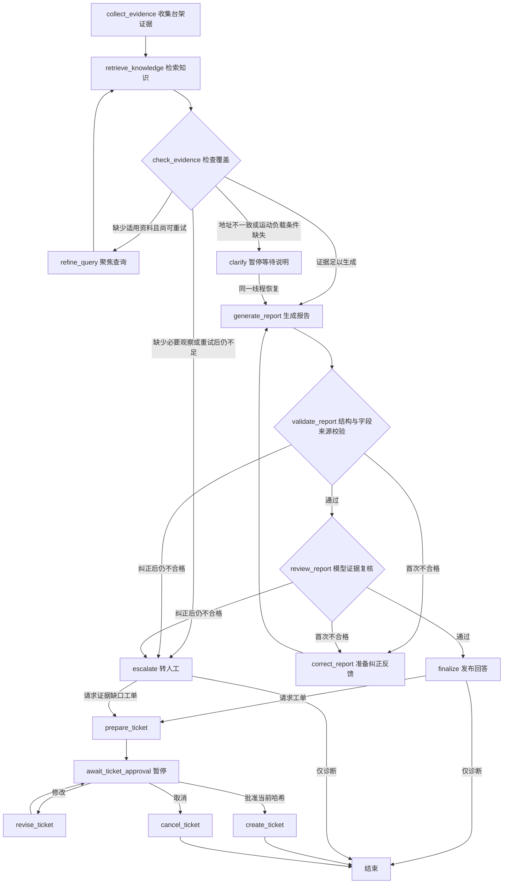

# LangGraph 工作流：节点、分支和恢复

当前实现为 `rag_demo/workflow.py`，版本 `bench-graph-v3-motion`。各处理步骤已拆为 StateGraph 节点，通过条件边控制执行。入口 `scripts/graph_bench.py` 支持初始化与关节响应两个任务；原来的 `scripts/diagnose_bench.py` 保留为初始化工具循环基线。工单操作详见 [本地工单闭环](ticket_workflow.md)。v1/v2 检查点不自动迁移，需新开线程。

## 图与节点



运行 `.\.venv\Scripts\python.exe scripts/graph_bench.py --show-graph` 可输出代码实际生成的 Mermaid，无需 API Key、网络或数据库。仅诊断路径直接结束；显式请求工单时，诊断后继续进入审批。

| 节点 | 执行方式与职责 |
| --- | --- |
| collect_evidence | 根据任务调用初始化五工具或运动三工具，建立原始证据和字段事实注册表 |
| retrieve_knowledge | 程序查询 Chroma，保存可引用的片段、版本与适用范围 |
| check_evidence | 检查必要工具是否成功、当前适用文档是否覆盖所需主题；不把相似度当充分性 |
| refine_query | 按缺失的配置、排障或初始化文档角色生成更聚焦的英文查询，仅重试一次 |
| clarify | 初始化地址差异或运动负载条件缺失时，用 interrupt() 等待用户说明；回复也可以是“不清楚” |
| generate_report | Claude 根据已收集的数据与用户背景提交结构化报告，不再控制所有诊断工具的调用顺序 |
| validate_report | Pydantic 和字段事实绑定校验，程序生成事实区及引用 |
| review_report | 单独模型请求检查解读、追问和兼容建议；保留复核意见 |
| correct_report | 将具体校验/复核错误送回生成节点，结构和语义问题共用一次纠正机会 |
| finalize / escalate | 仅发布通过检查的报告；未通过时说明缺口，不发布诊断草稿 |
| prepare_ticket / await_ticket_approval | 从证据生成草稿，保存修订号与哈希，暂停等待明确决定 |
| revise_ticket | 仅修改允许的人工文字字段，递增修订并重新等待批准 |
| create_ticket / cancel_ticket | 校验精确内容批准后幂等创建本地工单；取消则不创建 |

初始化异常需要配置与故障排查主题，正常快照需要台架范围和初始化规程。运动任务独立使用 `demo-joint-response-v1`，除两篇文档外，明确检查超调、调节时间、末段误差、负载条件与配置比较五个章节；请求工单再要求支持审批章节。缺失时聚焦重试一次，仍缺失则转人工。检查文档/章节及 metadata 不能保证所有引用与推断语义正确。模拟器仍是静态历史快照，没有实际运动或设备操作。

## 运行与跨进程恢复

```powershell
# 无需澄清的版本场景，直接走生成、校验和复核
.\.venv\Scripts\python.exe scripts/graph_bench.py --scenario version_mismatch

# 地址差异场景：在 clarify 暂停；终端会打印 Thread ID 和恢复命令
.\.venv\Scripts\python.exe scripts/graph_bench.py --scenario connection_timeout --thread-id demo-timeout-01

# 可在新的 PowerShell 进程中执行；不确定意图时直接如实回答
.\.venv\Scripts\python.exe scripts/graph_bench.py --resume demo-timeout-01 --reply "暂不清楚，请保留地址差异为待核查项。"
```

新线程可不指定 ID，程序会生成 UUID。已有线程不能作为新线程覆盖；完成的诊断不能继续 resume。已创建工单的同哈希确认只返回已有 ID。恢复时不可重新指定 scenario、question 或 --ticket，防止替换当前案件。回复为空、超长，或模型、知识/工作流版本漂移时明确拒绝。

### 关节响应任务

```powershell
# 条件完整的振荡工况：生成诊断、校验、证据评审
.\.venv\Scripts\python.exe scripts/graph_bench.py --task joint_response --scenario joint_tracking_oscillation

# 正常工况：仅针对这次单关节离线动作报告结果
.\.venv\Scripts\python.exe scripts/graph_bench.py --task joint_response --scenario joint_tracking_baseline

# 负载缺失：先暂停追问，恢复后生成诊断和待审批工单
.\.venv\Scripts\python.exe scripts/graph_bench.py --task joint_response --scenario joint_tracking_load_unknown --ticket --thread-id my-motion-01
.\.venv\Scripts\python.exe scripts/graph_bench.py --resume my-motion-01 --reply "暂不清楚本次负载与夹具是否更换，请保留未知项。"
```

`--task` 默认为 `initialization`，运动场景必须显式使用 `--task joint_response`；两种任务的场景不可混配。恢复时不要再传 `--task`，程序从检查点读取任务类型，选择对应知识版本。`--ticket` 只表示生成草稿的请求，草稿仍需审批；不加该参数则在报告后结束。

条件缺失分支在任何模型调用前暂停，用户回复不覆盖 null 或登记基准。只澄清一次；用户不清楚时继续形成带缺口的报告/草稿，不反复阻塞。运动报告使用独立生成提示词，评审增加 `motion_overclaim`，检查无依据的 PID 根因、虚构当前负载、整机通过、指标误读与自动调参建议。

SQLite checkpoint 位于 `data/checkpoints/diagnosis.sqlite3`，被 Git 忽略。状态保存任务类型、问题、证据、事实、检索片段、用户背景、路由、节点历史、重试计数、候选/最终报告和累计用量。API Key、模型客户端和数据库连接不进入状态。

恢复不重新收集台架数据或重新检索；继续使用暂停前的证据快照。用户回复单独保存为未验证的背景说明，不改变配置地址、握手版本或其他观察。`--resume` 支持澄清和工单审批两类中断；`--retry` 仅恢复已批准但未完成的本地工单创建。任意模型节点的 API 故障重试仍不在当前 CLI 范围内。

## LangSmith 中看什么

每次启动或恢复是一条 `bench-diagnosis-graph` Trace，包含 `bench-workflow` 和实际节点。相同 `thread_id` 将启动/恢复的运行关联起来；它们不是同一个连续在线进程。命令行同步显示 `Node`、`Route` 和失败原因。

- 暂停前可以看到 collect_evidence → retrieve_knowledge → check_evidence → clarify，模型用量为零。
- 恢复后从 clarify 继续，进入 generate_report → validate_report → review_report；通过后 finalize。
- 检索不足时可见 refine_query 回路；首次报告不合格时可见 correct_report 回路；仍失败则 escalate。

暂停问题、状态摘要、复核结果和节点记录写入 Trace；完整运行状态另存 `data/runs/graph-<run_id>.json`。用量按整个线程累计，包含生成和复核模型请求，重启后不会清零。后台执行记录通过 v2 API 回读，检查节点名确实可见。

## 已实现的边界与下一步

现有图最多两轮检索（第一次加一次聚焦重试）、两次报告生成和两次证据复核。模型没有自行绕过校验或无限循环的入口。失败时保存候选稿用于调试，但 CLI 不将候选稿当作合格诊断输出。

已实现两类诊断及本地工单草稿、修改/确认/取消和幂等创建，仍无 Web 界面或外部工单系统接入。暂停条件为地址差异、运动负载条件缺失，以及显式请求工单后的人工审批；一般报告中的问题不会全部自动变成阻塞点。
