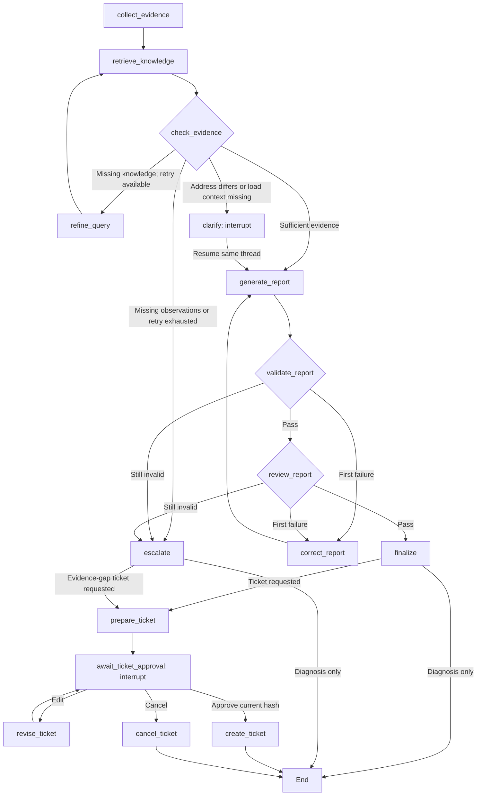

# LangGraph workflow: nodes, branches and recovery

The implementation is `rag_demo/workflow.py`, version `bench-graph-v3-motion`.
Processing steps are StateGraph nodes connected by conditional edges.
`scripts/graph_bench.py` supports initialization and joint-response tasks;
`scripts/diagnose_bench.py` remains the initialization tool-loop baseline.
See [Local ticket workflow](ticket_workflow.md) for ticket operations.
v1/v2 checkpoints are not automatically migrated; start a new thread.

## Graph and nodes



Run `.\.venv\Scripts\python.exe scripts/graph_bench.py --show-graph` to print
Mermaid generated from the actual graph without keys, network or a database.
Diagnosis-only runs end after reporting; ticket requests continue to approval.

| Node | Execution and responsibility |
| --- | --- |
| collect_evidence | Call five initialization tools or three motion tools; build raw evidence and the field-fact registry |
| retrieve_knowledge | Query Chroma and retain citable chunks, versions and scope |
| check_evidence | Check required tools and coverage by current applicable documents; similarity is not sufficiency |
| refine_query | Build focused English queries for missing configuration, troubleshooting or procedure roles; retry once |
| clarify | Use interrupt() for address discrepancies or missing load context; an honest unknown is a valid reply |
| generate_report | Claude submits a structured report from collected data and user context; it no longer controls all diagnostic tool ordering |
| validate_report | Pydantic and field-source checks; application renders facts and citations |
| review_report | Separate model request checks interpretations, questions and compatibility advice; retain reviews |
| correct_report | Return specific validation/review errors; structural and semantic issues share one correction attempt |
| finalize / escalate | Publish checked reports only; explain gaps without publishing failed diagnosis drafts |
| prepare_ticket / await_ticket_approval | Build an evidence-based draft, save revision/hash and wait for an explicit decision |
| revise_ticket | Edit permitted human-text fields, increment revision and require approval again |
| create_ticket / cancel_ticket | Verify exact-content approval and create idempotently, or cancel without creating |

Initialization failures require configuration and troubleshooting topics; healthy
snapshots require bench scope and initialization procedure. Motion uses
`demo-joint-response-v1`: besides two documents, coverage requires sections on
overshoot, settling time, final-window error, load context and configuration
comparison. Ticket requests additionally require support approval guidance.
Missing coverage gets one focused retry, then escalation. Section/metadata checks
cannot guarantee every citation or inference is semantically correct. Fixtures
are historical synthetic snapshots, with no hardware operation.

## Run and resume across processes

```powershell
# Version mismatch: generate, validate and review without clarification
.\.venv\Scripts\python.exe scripts/graph_bench.py --scenario version_mismatch

# Address discrepancy: pause and print a Thread ID and resume command
.\.venv\Scripts\python.exe scripts/graph_bench.py --scenario connection_timeout --thread-id demo-timeout-01

# Another PowerShell process may resume; state uncertainty honestly
.\.venv\Scripts\python.exe scripts/graph_bench.py --resume demo-timeout-01 --reply "I do not know. Retain the address discrepancy for verification."
```

Omit the ID for a generated UUID. Existing threads cannot be overwritten; completed
diagnoses cannot resume. Reapproving a created ticket with the same hash returns
its existing ID. Do not respecify scenario, question or `--ticket` on resume:
the case stays fixed. Empty/oversized replies and model, knowledge or workflow
version drift are rejected.

### Joint-response task

```powershell
# Complete conditions: diagnose, validate and review
.\.venv\Scripts\python.exe scripts/graph_bench.py --task joint_response --scenario joint_tracking_oscillation

# Baseline: conclusions apply only to this offline single-joint action
.\.venv\Scripts\python.exe scripts/graph_bench.py --task joint_response --scenario joint_tracking_baseline

# Missing load: clarify, then produce a report and draft awaiting approval
.\.venv\Scripts\python.exe scripts/graph_bench.py --task joint_response --scenario joint_tracking_load_unknown --ticket --thread-id my-motion-01
.\.venv\Scripts\python.exe scripts/graph_bench.py --resume my-motion-01 --reply "I do not know whether the payload or fixture changed. Retain the unknowns."
```

`--task` defaults to `initialization`; motion requires explicit
`--task joint_response`. Tasks/scenarios cannot be mixed. On resume omit
`--task`; the checkpoint supplies the task and knowledge version.
`--ticket` requests a draft, not approval. Otherwise the run ends after reporting.

Missing conditions pause before any model call. Replies cannot overwrite null
observations or registry baselines. Clarification happens once; unknown replies
lead to a report/draft retaining gaps rather than repeated blocking questions.
Motion has a separate prompt and `motion_overclaim` review category for unsupported
PID causes, invented current loads, whole-robot pass claims, metric misreadings
and automatic tuning.

Ignored SQLite checkpoints reside at `data/checkpoints/diagnosis.sqlite3`.
State includes task, question, evidence, facts, chunks, user context, routes,
node history, retry counters, candidate/final reports and cumulative usage.
Keys, model clients and database connections are excluded.

Resume reuses original evidence and retrieval. User replies are unverified context,
not changes to addresses, handshake versions or other observations. `--resume`
handles clarification and ticket approval. `--retry` only continues approved local
creation that did not finish; arbitrary model-node API recovery is outside CLI scope.

## What to inspect in LangSmith

Each start/resume has a `bench-diagnosis-graph` trace containing
`bench-workflow` and executed nodes. A shared `thread_id` links separate runs,
not one continuously running process. The CLI prints Node, Route and errors.

- Before clarification: collect_evidence → retrieve_knowledge → check_evidence → clarify, with zero model tokens.
- After resume: clarify → generate_report → validate_report → review_report → finalize on success.
- Missing retrieval shows refine_query; a first invalid report shows correct_report; repeated failure shows escalate.

Interrupt questions, summaries, reviews and node records appear in traces.
Full state is also exported to `data/runs/graph-<run_id>.json`. Usage accumulates
across the thread, including generation/review, and survives restarts. v2 API
read-back checks that executed node names are visible remotely.

## Bounds and current scope

There are at most two retrieval rounds (initial plus one retry), two report
generations and two reviews. The model cannot bypass validation or loop forever.
Failed candidates remain available for debugging but are not valid CLI diagnoses.

Both diagnostic tasks and local draft/edit/approve/cancel/idempotent-create
operations are implemented. The [Dashboard](dashboard.md) now provides a UI;
external ticket systems remain unconnected. Blocking conditions are address
discrepancies, missing motion load context and requested ticket approval;
ordinary report questions do not all become interrupts.
