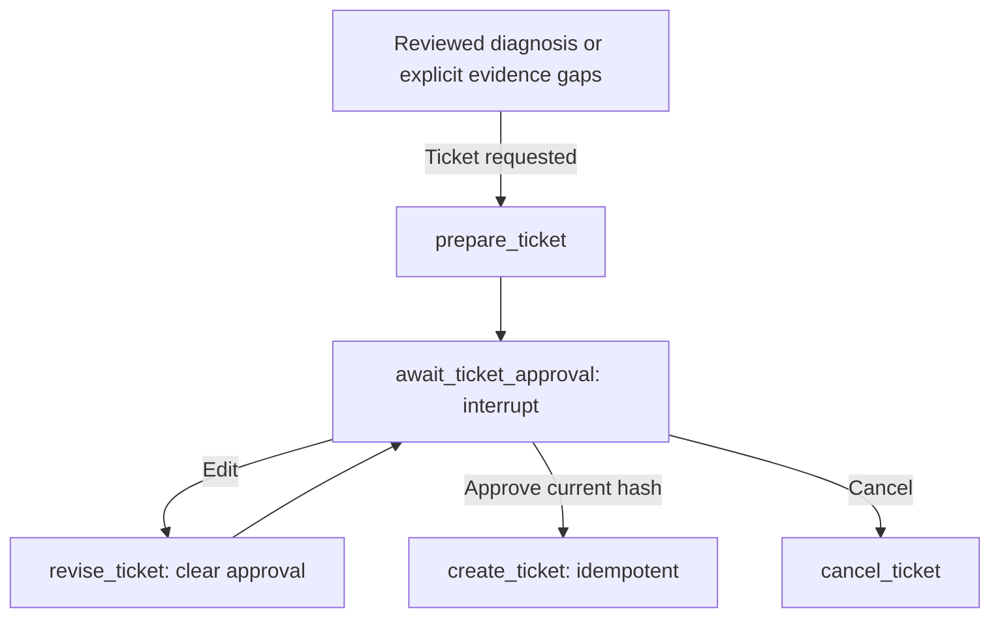

# Local ticket workflow

Entry point: `scripts/graph_bench.py`, workflow `bench-graph-v3-motion`.
Tickets stay local; nothing is sent to Jira, email or vendor support.
Diagnosis-only commands remain available. Start new threads for older checkpoints.

## Walkthrough

```powershell
.\.venv\Scripts\python.exe scripts/graph_bench.py --scenario version_mismatch --ticket
```

After diagnosis, a draft is prepared and execution pauses at `await_ticket_approval`.
The terminal shows the full readable preview, full draft JSON path, revision,
hash and copyable Approve, Edit and Cancel commands. No ticket exists yet.

`connection_timeout --ticket` first requests address clarification. Supply context
with the printed `--reply` command before reporting/approval.
Motion uses `--task joint_response --scenario joint_tracking_load_unknown --ticket`:
clarify load conditions, then prepare the report/draft. Schema `1.1` records
`task_type` and `test_id`, without inventing an initialization attempt for motion.
Missing fields/reasons remain in `evidence_gaps` even after review passes.
Approval, editing, cancellation and deduplication rules are shared.

### Approve

Review the draft and copy **Approve**. `--approve` must contain the complete hash
of the exact draft reviewed. Success returns `DEMO-TKT-...`, a local path and
`ticket_created` status. No extra model request is made.
Repeating approval returns the existing ID without calling creation again.
An old revision's hash cannot approve a revised draft.

### Edit and approve again

Create `edits.json`, for example:

```json
{
  "engineer_notes": "Verify the upgrade intent first. An engineer must approve configuration restoration.",
  "requested_support": "Assess restoration of the documented compatible baseline and the retest procedure."
}
```

Copy **Edit**, containing `--edit-draft edits.json --draft-hash CURRENT_HASH`.
Only these human-text fields may change:

- `title`: title.
- `description`: user problem description.
- `requested_support`: requested assistance.
- `engineer_notes`: explicitly identified human input.

Editing increments revision, changes the hash, invalidates approval and pauses
again. Review the revised draft and use its new Approve command. Facts, raw
checks, diagnostic references, snapshots and versions are protected. Human text
does not replace observations.

Exported draft JSON is a preview, not state input. Editing the file does not
change the workflow; submit patches through `--edit-draft`.

### Cancel

Copy **Cancel** (`--resume THREAD_ID --cancel`). Status becomes
`ticket_cancelled`; no ticket is created. Diagnosis/draft remain in the checkpoint.
A cancelled thread is not reopened; start a new support thread.

## Draft and approval binding

Drafts are deterministically built from saved state: bench, snapshot, startup
attempt or motion test, version/address facts and sources, raw checks/logs,
reviewed interpretations, open issues, knowledge chunks/versions and attachments.
There are no external uploads; check data is embedded in JSON.

An explicit `--ticket` can produce an evidence-gap draft after insufficient evidence
or review failure. Failed model interpretations are excluded. Human approval is
still required.

The approval node records thread ID, revision and SHA-256 content hash.
The model submits diagnosis only; it has no approval/creation tool. Approval
does not authorize device operation: no configuration changes, rollback, movement
or PID tuning.

## Idempotent creation and recovery

- Draft preview: `data/tickets/drafts/<hash>.json`.
- Authoritative records: `data/tickets/tickets.sqlite3`.
- Recoverable export matching the approved draft: `data/tickets/DEMO-TKT-....json`.
- Checkpoint: `data/checkpoints/diagnosis.sqlite3`.

All are ignored by Git. SQLite transactions and a unique
`(thread_id, draft_revision)` prevent duplicates. Different content for the same
key is rejected. Repeated requests return the original ID/time. Exports use
temporary files and atomic replacement. If export fails after commit, retry
repairs it from the authoritative database.

If approved creation fails, or execution stops after creation but before saving
the graph checkpoint:

```powershell
.\.venv\Scripts\python.exe scripts/graph_bench.py --retry YOUR_THREAD_ID
```

Only saved approval with `create_ticket` next can retry. It does not regenerate
diagnosis, request approval again or duplicate the ticket. Arbitrary model-node
API failures are not supported. Completed threads cannot create changed content;
start a new thread. `bench-graph-v1` checkpoints are not automatically migrated,
so old state cannot be mistaken for ticket-approval state.

## Graph and traces

Nodes: `prepare_ticket`, `await_ticket_approval`, `revise_ticket`,
`create_ticket`, `cancel_ticket`. Creation includes `create_local_ticket`.



Each pause, edit and approval has a separate trace linked by `thread_id`.
Nodes, drafts, revisions, decisions and receipts are traceable. CLI approval is
a demo entry point, not a multi-user authentication system.
