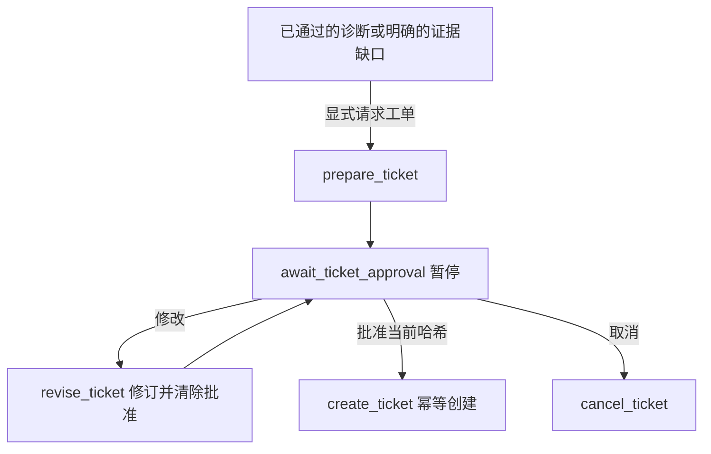

# 本地工单闭环

入口：`scripts/graph_bench.py`，当前版本 `bench-graph-v3-motion`。工单仅保存在本地，不发送 Jira、邮件或厂商支持系统。原来的纯诊断命令继续可用。旧工作流检查点需新开线程。

## 体验流程

```powershell
.\.venv\Scripts\python.exe scripts/graph_bench.py --scenario version_mismatch --ticket
```

诊断结束后会生成草稿，并在 `await_ticket_approval` 暂停。终端显示完整的可读预览、完整草稿 JSON 路径、修订号、哈希，以及可直接复制的 Approve、Edit 和 Cancel 命令。此时还没有创建工单。

使用 `connection_timeout --ticket` 时会先遇到地址澄清；复制终端的 `--reply` 命令补充背景后，才进入报告和工单审批。

关节任务使用 `--task joint_response --scenario joint_tracking_load_unknown --ticket`，先澄清负载条件，再生成报告与草稿。草稿 schema 为 `1.1`，显式保存 `task_type` 与 `test_id`；运动任务不伪造初始化启动尝试。当前缺失字段及原因保留在 `evidence_gaps`，即使报告通过评审也不会丢弃。审批、修改、取消和去重规则与初始化一致。

### 确认

审阅后复制终端打印的 **Approve** 命令。`--approve` 的值必须是本次所见草稿的完整哈希。确认后返回 `DEMO-TKT-...` 和本地文件路径，状态变为 `ticket_created`。不会额外调用模型。

同一工单再次使用相同确认命令，CLI 会返回已存在的 ID，不再调用创建节点。旧修订号对应的哈希不能批准新草稿。

### 修改后重新确认

用编辑器创建 `edits.json`，例如：

```json
{
  "engineer_notes": "请先核实升级意图，由工程师批准配置恢复方案。",
  "requested_support": "请评估恢复已记录兼容基线的方案与复测步骤。"
}
```

复制终端的 **Edit** 命令，它包含 `--edit-draft edits.json --draft-hash 当前哈希`。允许修改的字段只有：

- `title`：标题。
- `description`：用户问题描述。
- `requested_support`：请求的支持。
- `engineer_notes`：明确标注为人工输入的备注。

修改后修订号增加、哈希改变，原确认失效，流程再次暂停。检查新草稿后使用新 Approve 命令。事实、原始检查、诊断引用、快照和版本不能通过编辑入口修改；人工文字也不会替换这些观察值。

导出的草稿 JSON 是预览副本，不是状态输入。直接编辑该文件不会修改工作流；请始终通过 `--edit-draft` 提交字段补丁。

### 取消

复制终端的 **Cancel** 命令（`--resume 线程ID --cancel`）。取消后状态为 `ticket_cancelled`，不创建本地工单；原诊断和草稿留在检查点中用于追溯。取消的线程不重新打开，若需新请求则新建线程。

## 草稿和审批绑定

草稿由已保存的状态确定性生成，包含台架、快照和启动尝试、版本与地址事实及其来源、原始检查和日志、已通过复核的解读、未解决事项、知识片段与版本，以及附件清单。当前无外部上传附件，检查数据直接嵌入 JSON。

如果诊断因证据不足或复核失败转人工，仍可按显式 `--ticket` 请求准备证据缺口草稿；其中不收录未通过的模型推断。创建仍需人工确认。

审批记录绑定线程 ID、草稿修订号和 SHA-256 内容哈希，审批节点才会生成记录。模型只提交诊断，没有审批或创建工单工具。用户批准工单不等于批准设备操作；系统仍不执行改配置、回滚、运动或 PID 调参。

## 幂等创建与恢复

- 草稿预览：`data/tickets/drafts/<hash>.json`。
- 正式本地记录：`data/tickets/tickets.sqlite3`，SQLite 是权威记录。
- 可读导出：`data/tickets/DEMO-TKT-....json`，内容与已批准草稿一致。
- 工作流检查点：`data/checkpoints/diagnosis.sqlite3`。

以上均被 Git 忽略。SQLite 事务和 `(thread_id, draft_revision)` 唯一约束防止重复创建；同一键内容不同则拒绝覆盖。重复请求返回原 ID 和创建时间。导出使用临时文件加原子替换；若导出失败，已提交的数据库记录保留，重试可修复导出。

若已经批准，但本地创建执行失败或在创建后、写入图检查点前中断，可使用：

```powershell
.\.venv\Scripts\python.exe scripts/graph_bench.py --retry 你的线程ID
```

此入口只允许恢复已保存批准记录且下一节点为 `create_ticket` 的线程。它不重新生成诊断、不再次请求审批，也不重复创建工单。它不支持任意模型节点的 API 故障重试。

已完成线程不能换内容重新创建；如需新的支持请求，应新建线程。已有 `bench-graph-v1` 检查点不自动迁移到新版，需新建线程，以避免把旧状态误作已具备工单审批语义。

## 图和 Trace

新增节点为 `prepare_ticket`、`await_ticket_approval`、`revise_ticket`、`create_ticket`、`cancel_ticket`。创建节点下还有 `create_local_ticket` 工具记录。



每次暂停、修改、确认都有独立 Trace，通过同一 `thread_id` 关联。图节点、草稿、修订号、审批决定和创建结果均可追踪。本地 CLI 的审批是演示工作流入口，不是多用户身份认证系统。
